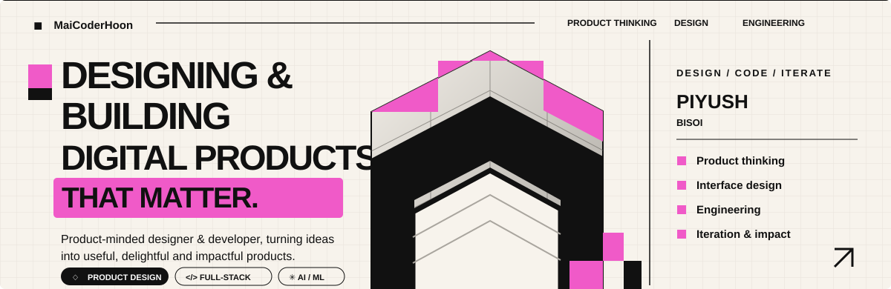
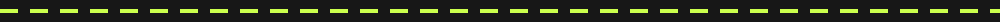
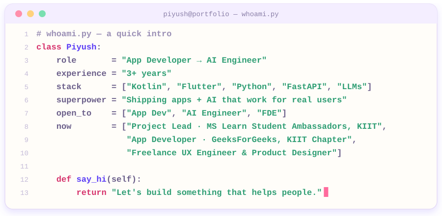
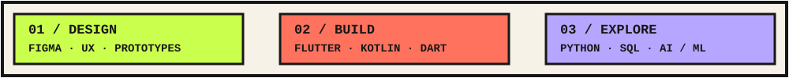
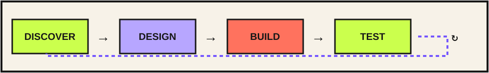
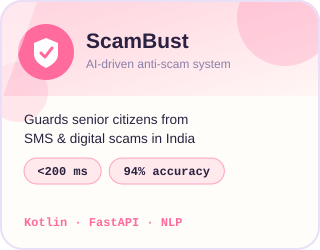
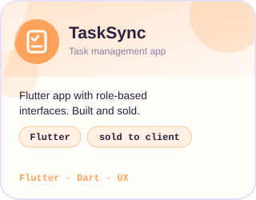
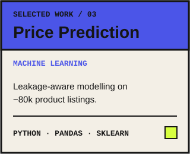
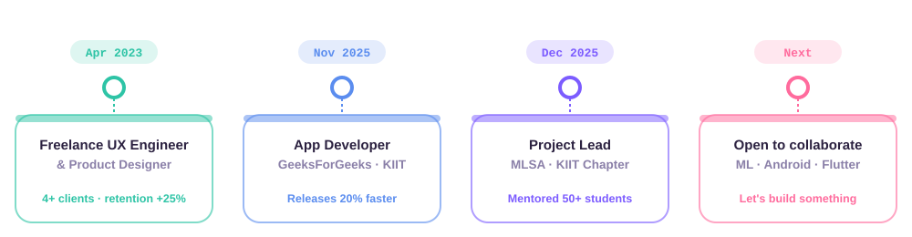
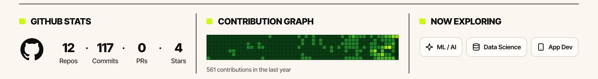

## ✳︎ Hey, I'm Piyush!

I'm a developer with a designer's eye. I enjoy the messy, fun middle ground where **product thinking, interface design and engineering** meet — turning a vague “what if?” into something people can actually use.

Right now, I'm exploring **app development, applied AI/ML and better ways to build useful products.** I like learning by making, breaking, debugging, and making it a little better.

## 🧰 My current toy box

| Design & product | App engineering | Data & AI |
|:--|:--|:--|
| UI/UX · Figma · Prototyping | Kotlin · Flutter · Dart | Python · SQL |
| Design systems · User flows | Android · Jetpack Compose | FastAPI · scikit-learn |
| Product thinking | Clean Architecture | LLMs · NLP · Generative AI |

## 🔁 How I like to build

I care about the whole loop: understanding the problem, shaping the experience, building the system, and checking whether it actually works. Pretty pixels are nice. Useful pixels are nicer.

## 🚀 Things I've been tinkering with

<table><tr>
<td></td>
<td></td>
<td></td>
</tr></table>

<b>🔎 A little more about the price-prediction project</b>

- Worked with a dataset of approximately **80k listings** and 25 features.
- Identified and removed a target-leakage path involving final price, price and discount.
- Built a scikit-learn preprocessing and modelling pipeline with ColumnTransformer and train/test separation.
- Explored Ridge, Random Forest and Gradient Boosting models.

## 🧭 The journey (still loading…)

Alongside building, I've been involved in student tech communities and collaborative projects — including work with the **GeeksforGeeks KIIT Chapter** and **Microsoft Learn Student Ambassadors, KIIT**.

## 📚 Recently added to the brain

## 📈 The GitHub arcade

## 💬 Got an idea? Let's make it real.

**Open to interesting problems, thoughtful collaborations and good conversations.**

*Stay curious. Ship things. Repeat.* ✳︎

