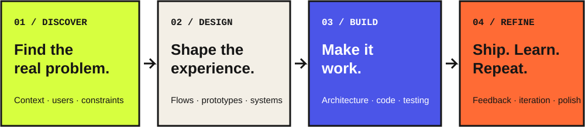

## 01 / The short version

I'm Piyush — a developer with a designer's eye. I like working where **product thinking, interface design and engineering** overlap: understanding a problem, shaping the experience, then building the thing.

Currently exploring app development, applied AI/ML and the systems that make products useful.

## 02 / What I work with

| Product & interface | Application engineering | Data & intelligent systems |
|:--|:--|:--|
| UI/UX · Figma · Prototyping | Kotlin · Flutter · Dart | Python · SQL |
| Design systems · User flows | Android · Jetpack Compose | FastAPI · scikit-learn |
| Product thinking | Clean Architecture | LLMs · NLP · Generative AI |

## 03 / From rough idea to real product

I care about the full loop — not just making a screen look finished, but making sure the underlying experience works.

## 04 / Selected work

A few projects across applied AI, mobile products and machine learning.

<table><tr>
<td></td>
<td></td>
<td></td>
</tr></table>

<b>Notes from the price-prediction project</b> — feature engineering, leakage checks & modelling

- Worked with a dataset of approximately **80k listings** and 25 features.
- Identified and removed a target-leakage path involving final price, price and discount.
- Built a scikit-learn preprocessing and modelling pipeline with ColumnTransformer and train/test separation.
- Explored Ridge, Random Forest and Gradient Boosting models.

## 05 / The path so far

Alongside building, I've been involved in student tech communities and collaborative projects — including work with the GeeksforGeeks KIIT Chapter and Microsoft Learn Student Ambassadors, KIIT.

## 06 / Learning shelf

## 07 / Open tabs

## 08 / Say hello

**Have an interesting problem, product idea or build to collaborate on?**

*Good products happen when thoughtful design meets careful engineering.*

