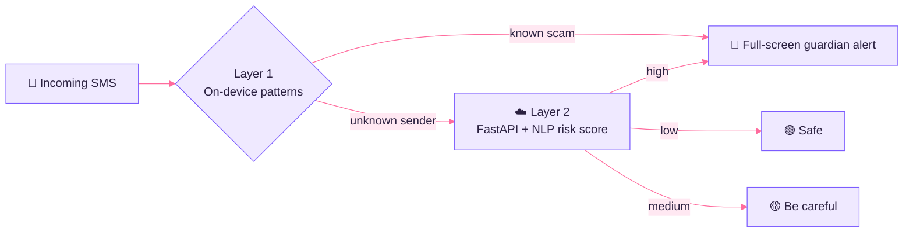
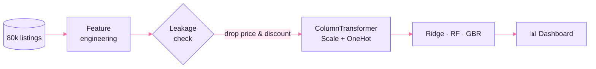

 

## 🌸 Hello, world

  

## 🧰 Tech Toolbox

  

<table>
<tr>
<td width="25%" valign="top">

**🧠 ML & Data** 
NLP · NumPy · Pandas · Feature Engineering · Linear Algebra · Probability & Stats · GenAI · LLMs

</td>
<td width="25%" valign="top">

**💻 Languages** 
Python · SQL · Kotlin · Java · C++ · Dart · C

</td>
<td width="25%" valign="top">

**🎨 Design Engineering** 
Figma · Product Design · Component Standardization · Hi-Fi Prototyping · UX Engineering

</td>
<td width="25%" valign="top">

**🏗️ Architecture** 
Clean Architecture · Android SDK · Jetpack Compose · Flutter · RDBMS · Git

</td>
</tr>
</table>

## 🚀 Featured Projects

 

<b>🛡️ ScamBust — AI-Driven Anti-Scam System</b> &nbsp;·&nbsp; <i>click to fold</i>

 

> A digital guardian that protects senior citizens in India from SMS and digital scams, with a simple **Green / Yellow / Red** safety status.

- ⚡ **FastAPI + Jetpack Compose** ecosystem processing threat data in **under 200 ms**
- 🧠 **Dual-layer NLP classifier** (on-device patterns + cloud analysis) at **94% accuracy**, cutting accidental scam-link clicks by **90%**
- ♿ Senior-first UX: high-contrast colors and 60 dp+ touch targets

`Kotlin` `Jetpack Compose` `Retrofit` `FastAPI` `Pydantic` `NLP`

<b>🛒 Flipkart Price Prediction — Leakage-Aware ML Pipeline</b> &nbsp;·&nbsp; <i>click to unfold</i>

 

> End-to-end scikit-learn pipeline on **~80,000 listings × 25 features**: EDA → feature engineering → leakage detection → modelling → evaluation.

- 🔍 Caught a **perfect-leakage trap** (`final_price = price × (1 − discount%)`) and removed it, so the scores stay honest
- 🧪 Custom features: `engagement`, `stock_sold_ratio`, `listing_age_days`, `payment_modes_count`
- 🧱 `ColumnTransformer` + `Pipeline` with strict train/test separation
- 📊 Generates a 9-panel EDA and evaluation dashboard

`Python` `Pandas` `NumPy` `scikit-learn` `Matplotlib` `Seaborn`

<b>📋 TaskSync — Task Management App</b> &nbsp;·&nbsp; <i>click to unfold</i>

 

> A **Flutter** task app with role-specific interfaces, built and **sold to a client** 🤝

`Flutter` `Dart` `UX Design`

## 🧭 Journey

| When | What | Impact |
|---|---|---|
| **Dec 2025 → Now** | 🏅 **Project Lead**, Microsoft Learn Student Ambassadors · KIIT | Mentored **50+ students**; shared token library sped design-dev handoff by **40%** |
| **Nov 2025 → Now** | 📱 **App Developer**, GeeksForGeeks · KIIT Chapter | Faster releases (**+20%**), modular patterns cut maintenance by **30%** |
| **Apr 2023 → Now** | 🎨 **Freelance UX Engineer & Product Designer** | Full SDLC for **4+ clients**; user retention **+25%**, maintenance overhead **−15%** |

## 🎓 Certifications

## 📊 GitHub Garden

  

  

  

## 🐍 Play Mode

  

## 💬 Thought of the Day

  

## 🤝 Let's Connect

**Open to collaborating on ML pipelines, Android / Flutter products and data-driven product design.**

  

<i>"Make it work, make it honest, make it beautiful."</i> ✨

