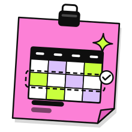
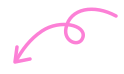
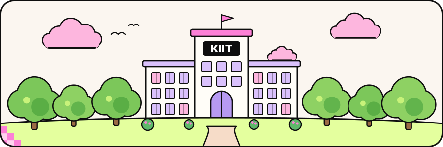

<!--
  Profile README for github.com/MaiCoderHoon (C1: whimsical & playful).

  All copy here is real Markdown/HTML text, so it stays selectable and searchable.
  Graphics live in assets/ and are rebuilt with `python .github/scripts/build_assets.py`,
  which never edits this file. The two stats cards are served from the `output` branch
  and refreshed every 10 minutes by .github/workflows/stats.yml.
-->

  
  &nbsp;<b>MaiCoderHoon</b>&nbsp;&nbsp;
  &nbsp;
  Designer&nbsp;&nbsp;/&nbsp;&nbsp;Developer&nbsp;&nbsp;/&nbsp;&nbsp;Builder

# Hi, I'm Piyush 

### Designing & Building Digital Products That&nbsp;Matter.

Product designer & developer, building useful, delightful and impactful digital products for students, creators and real-world problems.

 Bhubaneswar, India 
 KIIT University

**Product Design** &nbsp;&nbsp; **Full-Stack Dev** &nbsp;&nbsp; **AI/ML**

 

##  Currently Building

### [Omni KIIT ↗︎](https://github.com/MaiCoderHoon?tab=repositories)

Campus super-app for KIIT students. 
Not public yet, so this link opens my repositories.

 

### [SmartSchedule ↗︎](https://github.com/MaiCoderHoon/SmartSelector)

AI-driven academic section optimizer. 
Helps students compare and rank sections by faculty quality.

 

##  More Projects

<a href="https://github.com/MaiCoderHoon/RootRunner"><b>RootRunner ↗︎</b></a> 
Iterative DNS resolution engine with TTL-aware caching, in Python.

<a href="https://github.com/MaiCoderHoon/scamBust"><b>ScamBust ↗︎</b></a> 
AI-powered SMS scam detection that helps protect senior citizens.

<a href="https://github.com/MaiCoderHoon/flipkart-price-prediction"><b>Price Prediction ↗︎</b></a> 
End-to-end ML pipeline that predicts Flipkart product prices.

<a href="https://github.com/MaiCoderHoon/wakewise"><b>WakeWise ↗︎</b></a> 
Smart alarm app that builds morning routines with wake-up challenges.

##  My Approach

  &nbsp; <b>Discover</b> — understand the problem. 
  &nbsp; <b>Design</b> — explore &amp; shape solutions. 
  &nbsp; <b>Build</b> — turn ideas into reality. 
  &nbsp; <b>Iterate</b> — improve with real feedback.

##  Toolkit

  
  
  
  
  
  
  
  
  
  
  
  
  
  

**Languages:** Python · SQL · Kotlin · Java · C++ · Dart · C 
**Frameworks & libraries:** Flutter · Jetpack Compose · FastAPI · Pandas · scikit-learn 
**Design & tools:** Figma · Git

##  GitHub Stats

  
  

Both cards are rebuilt from the GitHub API every 10 minutes.

## Let's Build Something Cool! 

Open to collaborations, product ideas and internship opportunities.

  <a href="mailto:piyush993bisoi@outlook.com">&nbsp;<b>Email</b></a>&nbsp;&nbsp;&nbsp;
  <a href="https://www.linkedin.com/in/piyush-bisoi">&nbsp;<b>LinkedIn</b></a>&nbsp;&nbsp;&nbsp;
  <a href="https://github.com/MaiCoderHoon">&nbsp;<b>GitHub</b></a>

