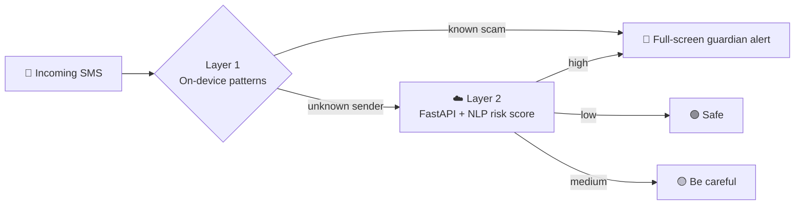
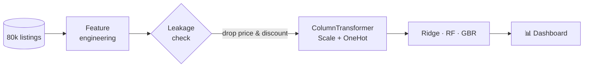

<div align="center">


<a href="https://git.io/typing-svg">
  
</a>

<br/>

<a href="https://www.linkedin.com/in/piyush-bisoi"></a>
<a href="mailto:piyush993bisoi@outlook.com"></a>
<a href="https://github.com/MaiCoderHoon?tab=repositories"></a>


</div>


## ⚡ `whoami`

```python
class Piyush:
    role      = "Data & Product Engineer"
    experience = "3+ years"
    stack     = ["Python", "SQL", "Kotlin", "Flutter", "FastAPI"]
    superpower = "Merging ML principles with Clean Architecture"
    currently = [
        "Project Lead @ Microsoft Learn Student Ambassadors (KIIT)",
        "App Developer @ GeeksForGeeks (KIIT)",
        "Freelance UX Engineer & Product Designer",
    ]
    obsessed_with = ["low-latency systems", "data governance", "leakage-free ML"]

    def say_hi(self):
        return "Let's build something that actually helps people. 🚀"
```


## 🧰 Tech Arsenal

<div align="center">


<br/><br/>


</div>

| 🧠 Machine Learning & Data | 💻 Languages | 🎨 Design Engineering | 🏗️ Architecture |
|---|---|---|---|
| NLP · NumPy · Pandas · Feature Engineering · Linear Algebra · Probability & Stats · GenAI · LLMs | Python · SQL · Kotlin · Java · C++ · Dart · C | Figma · Product Design · Component Standardization · Hi-Fi Prototyping · UX Engineering | Clean Architecture · Android SDK · Jetpack Compose · Flutter · RDBMS · Git |


## 🚀 Featured Projects

<div align="center">

<a href="https://github.com/MaiCoderHoon/scambust">
  
</a>
<a href="https://github.com/MaiCoderHoon/flipkart-price-prediction">
  
</a>

</div>

### 🛡️ ScamBust — AI-Driven Anti-Scam System
> A digital guardian that protects senior citizens in India from SMS and digital scams, with a simple **Green / Yellow / Red** safety status.

- ⚡ **FastAPI + Jetpack Compose** ecosystem processing threat data in **under 200 ms**
- 🧠 **Dual-layer NLP classifier** (on-device patterns + cloud analysis) at **94% accuracy**, cutting accidental scam-link clicks by **90%**
- ♿ Senior-first UX: high-contrast colors and 60 dp+ touch targets



`Kotlin` `Jetpack Compose` `Retrofit` `FastAPI` `Pydantic` `NLP`

### 🛒 Flipkart Price Prediction — Leakage-Aware ML Pipeline
> End-to-end scikit-learn pipeline on **~80,000 listings × 25 features**: EDA → feature engineering → leakage detection → modelling → evaluation.

- 🔍 Caught a **perfect-leakage trap** (`final_price = price × (1 − discount%)`) and removed it, so scores stay honest
- 🧪 Custom features: `engagement`, `stock_sold_ratio`, `listing_age_days`, `payment_modes_count`
- 🧱 `ColumnTransformer` + `Pipeline` with strict train/test separation
- 📊 Generates a 9-panel EDA and evaluation dashboard



`Python` `Pandas` `NumPy` `scikit-learn` `Matplotlib` `Seaborn`

### 📋 TaskSync — Task Management App
> A **Flutter** task app with role-specific interfaces, built and **sold to a client** 🤝

`Flutter` `Dart` `UX Design`


## 🧭 Journey

| When | What | Impact |
|---|---|---|
| **Dec 2025 → Now** | 🏅 **Project Lead**, Microsoft Learn Student Ambassadors · KIIT | Mentored **50+ students**; shared token library sped design-dev handoff by **40%** |
| **Nov 2025 → Now** | 📱 **App Developer**, GeeksForGeeks · KIIT Chapter | Faster releases (**+20%**), modular patterns cut maintenance by **30%** |
| **Apr 2023 → Now** | 🎨 **Freelance UX Engineer & Product Designer** | Full SDLC for **4+ clients**; user retention **+25%**, maintenance overhead **−15%** |

## 🎓 Certifications

<div align="center">


</div>


## 📊 GitHub Analytics

<div align="center">


<br/>


<br/>


<br/><br/>


</div>

## 🐍 Contribution Snake

<div align="center">
<picture>
  <source media="(prefers-color-scheme: dark)" srcset="https://raw.githubusercontent.com/MaiCoderHoon/MaiCoderHoon/output/github-snake-dark.svg" />
  <source media="(prefers-color-scheme: light)" srcset="https://raw.githubusercontent.com/MaiCoderHoon/MaiCoderHoon/output/github-snake.svg" />
  
</picture>
</div>


## 🤝 Let's Connect

<div align="center">

**Open to collaborating on ML pipelines, Android / Flutter products and data-driven product design.**

<a href="https://www.linkedin.com/in/piyush-bisoi"></a>
<a href="mailto:piyush993bisoi@outlook.com"></a>

<br/><br/>

<i>"Make it work, make it honest, make it beautiful."</i> ✨


</div>
