<!-- The poster below is generated. Edit .github/scripts/build_assets.py and run it to change it. -->

<a href="https://github.com/MaiCoderHoon">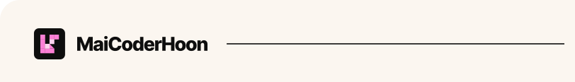</a><a href="#about">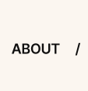</a><a href="#projects">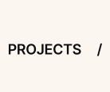</a><a href="#toolkit">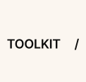</a><a href="#now">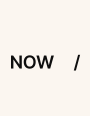</a> 
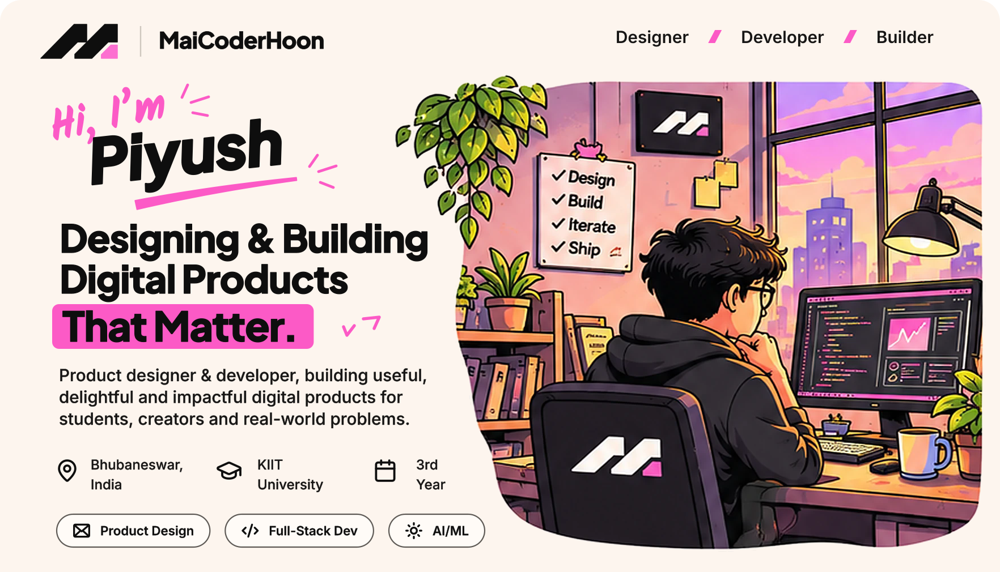 
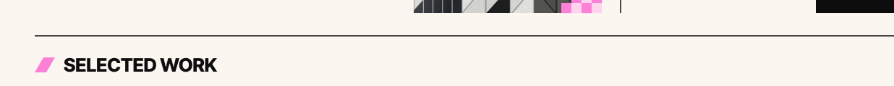<a href="https://github.com/MaiCoderHoon?tab=repositories">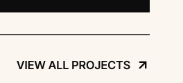</a> 
<a href="https://github.com/MaiCoderHoon?tab=repositories">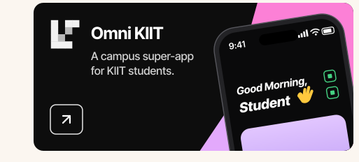</a><a href="https://github.com/MaiCoderHoon/SmartSelector">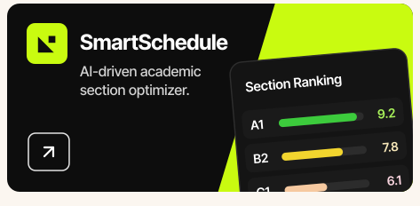</a><a href="https://github.com/MaiCoderHoon/RootRunner">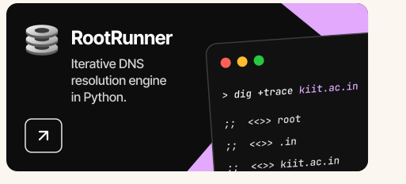</a> 
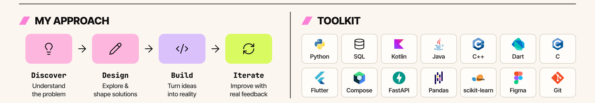 
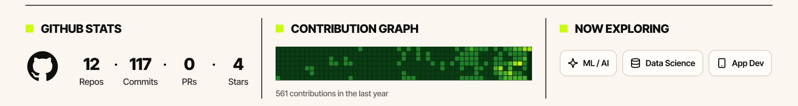 
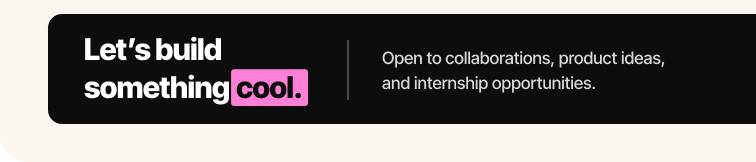<a href="mailto:buildgreat4wld@gmail.com">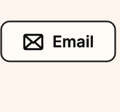</a><a href="https://www.linkedin.com/in/piyush-bisoi">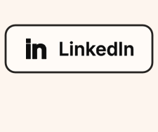</a><a href="https://github.com/MaiCoderHoon">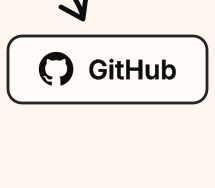</a>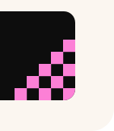

