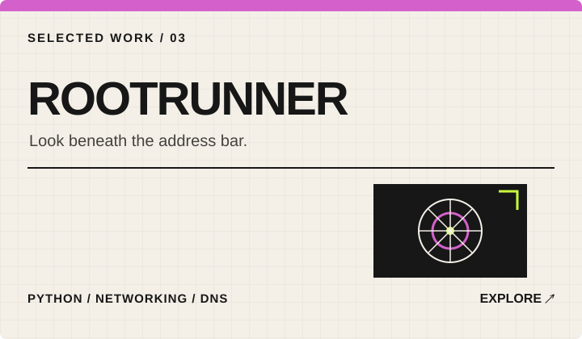
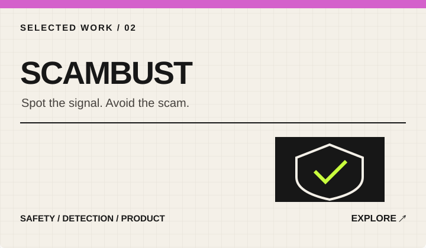
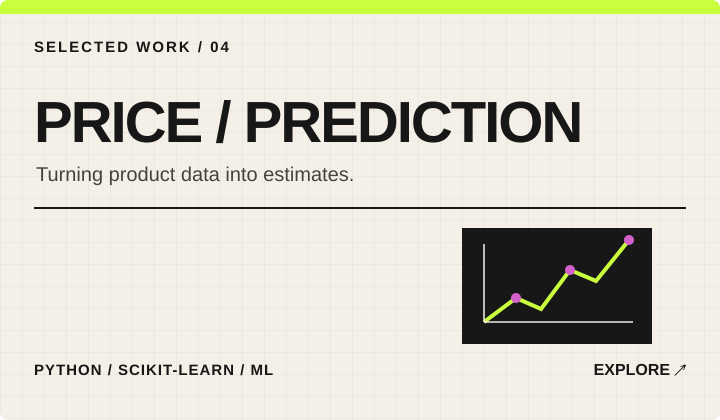
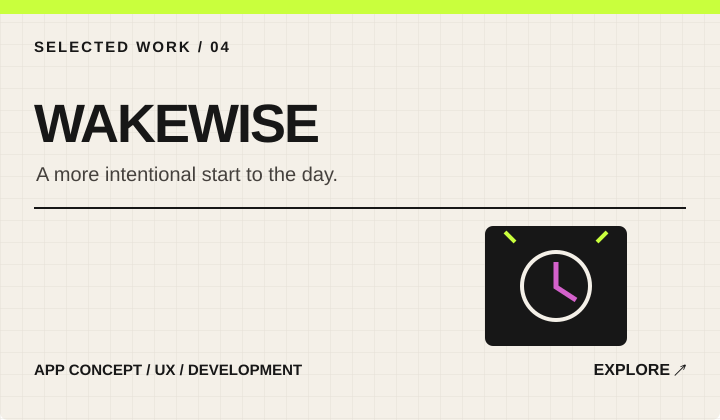

---

## DESIGNING & BUILDING DIGITAL PRODUCTS THAT MATTER.

I'm Piyush — a **product-minded designer and developer** interested in the space where thoughtful experiences meet useful technology.

I enjoy taking ideas from a rough sketch to a working product: understanding the problem, shaping the interface, building the system, and iterating until the details feel right. My current focus is **product design, app development, and applied AI/ML**.

**PRODUCT THINKING**　/　**DESIGN CRAFT**　/　**ENGINEERING**

---

## CURRENTLY BUILDING

| OMNI KIIT | SmartSchedule |
|:--|:--|
| A student-first campus companion concept bringing schedules, opportunities and campus information together. | An academic section optimizer exploring schedule data and faculty preferences to help students make better choices. |
| `Flutter` `Product UX` `Mobile` | `React` `FastAPI` `AI-assisted parsing` |

## SELECTED WORK

  
  
  
  

---

## MY APPROACH

<table>
<tr>
<td align="center" width="25%"><h3>01 / DISCOVER</h3>Understand the problem and the people experiencing it.</td>
<td align="center" width="25%"><h3>02 / DESIGN</h3>Explore flows, interactions, and visual systems.</td>
<td align="center" width="25%"><h3>03 / BUILD</h3>Turn the strongest idea into a working product.</td>
<td align="center" width="25%"><h3>04 / ITERATE</h3>Test, learn, refine, and make it better.</td>
</tr>
</table>

## TOOLKIT

| DESIGN & PRODUCT | APP & WEB ENGINEERING | DATA & AI |
|:--|:--|:--|
| UI/UX · Figma · Prototyping | Flutter · Dart · Kotlin | Python · SQL |
| Design systems · User flows | React · TypeScript | FastAPI · scikit-learn |
| Product thinking | Android · Jetpack Compose | LLMs · NLP · Generative AI |

## GITHUB ACTIVITY

---

## NOW EXPLORING

`APP DEVELOPMENT`　`AI / ML`　`DATA SCIENCE`　`PRODUCT DESIGN`

---

### LET'S BUILD SOMETHING GOOD.

Open to interesting problems, thoughtful collaborations, and opportunities to design and build useful products.

*Stay curious. Design with intent. Ship with care.*

