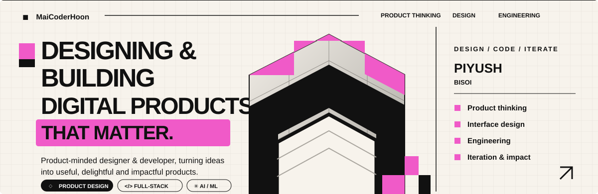
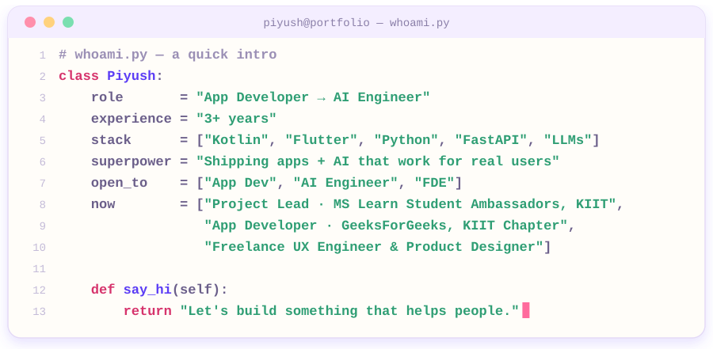
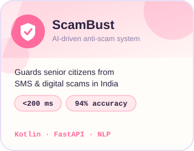
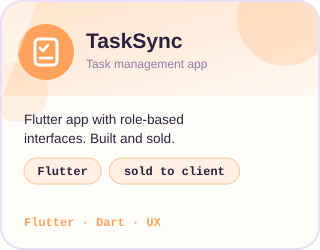
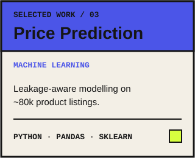
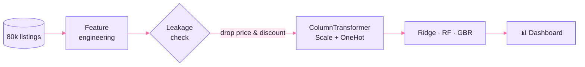
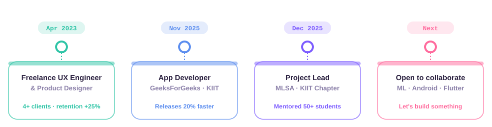

 

  

## 🌸 Hello, world

  

## 🚀 Featured Projects

<table>
<tr>
<td align="center"></td>
<td align="center"></td>
<td align="center"></td>
</tr>
</table>

<b>🛒 How the pricing pipeline works</b> &nbsp;·&nbsp; <i>click to unfold</i>

 

- 🔍 Caught a **perfect-leakage trap** (`final_price = price × (1 − discount%)`) and removed it, so the scores stay honest
- 🧪 Custom features: `engagement`, `stock_sold_ratio`, `listing_age_days`, `payment_modes_count`
- 🧱 `ColumnTransformer` + `Pipeline` with strict train/test separation, plus a 9-panel EDA dashboard

## 🧭 Journey

  

## 🎓 Certifications

## 📊 GitHub Garden

  

## 🐍 Play Mode

  

## 🤝 Let's Connect

**Open to App Developer, AI Engineer and Forward Deployed Engineer roles, and to building applied-AI products on Android / Flutter.**

  

<i>"Make it work, make it honest, make it beautiful."</i> ✨

