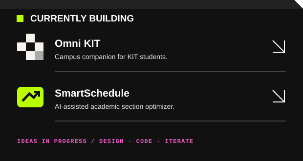
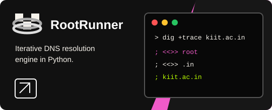
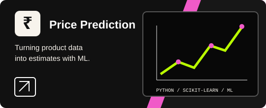

<a href="#about">ABOUT</a>　/　<a href="#selected-work">PROJECTS</a>　/　<a href="#toolkit">TOOLKIT</a>　/　<a href="#now-exploring">NOW</a>　/　<a href="#connect">CONNECT ↗</a>

 

<table>
<tr>
<td width="57%" valign="top">

<h2 id="about">ABOUT</h2>

I'm <strong>Piyush</strong>, a product-minded designer and developer. I turn ideas into useful, thoughtful digital products by connecting product thinking, interface design, and engineering.

<code>◇ Product Design</code>　<code>&lt;/&gt; Full-Stack Dev</code>　<code>✳ AI / ML</code>

</td>
<td width="43%" valign="top">

</td>
</tr>
</table>

---

## SELECTED WORK <a href="https://github.com/MaiCoderHoon?tab=repositories">↗ VIEW ALL PROJECTS</a> 

---

<table>
<tr>
<td width="46%" valign="top">

<h2>MY APPROACH</h2>

<strong>💡 DISCOVER　→　✎ DESIGN　→　&lt;/&gt; BUILD　→　⟳ ITERATE</strong> Understand the problem　　Explore a solution　　Make it real　　Learn and improve

</td>
<td width="54%" valign="top">

<h2 id="toolkit">TOOLKIT</h2>

<code>Figma</code>　<code>Flutter</code>　<code>React</code>　<code>Python</code> <code>TypeScript</code>　<code>Node.js</code>　<code>Postgres</code>　<code>Gemini</code>

</td>
</tr>
</table>

---

<table>
<tr>
<td width="34%" valign="top">

<h2>GITHUB STATS</h2>

</td>
<td width="36%" valign="top">

<h2>CONTRIBUTION GRAPH</h2>

</td>
<td width="30%" valign="top">

<h2 id="now-exploring">NOW EXPLORING</h2>

<code>✧ AI / ML</code> <code>◉ Data Science</code> <code>▣ App Dev</code>

</td>
</tr>
</table>

 

<a href="mailto:buildgreat4wld@gmail.com">✉ EMAIL</a>　/　<a href="https://www.linkedin.com/in/piyush-bisoi">in LINKEDIN</a>　/　<a href="https://github.com/MaiCoderHoon">◉ GITHUB</a>

Stay curious. Design with intent. Ship with care.

